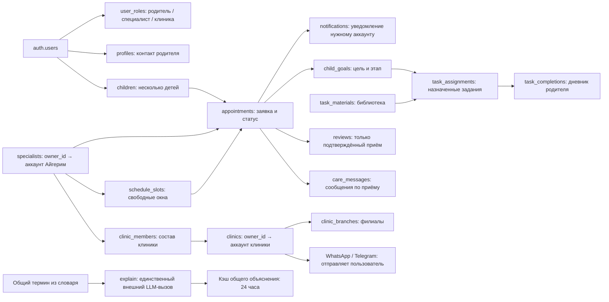

# Карта связей Birge Bol

Актуальная интерактивная карта: https://birge-bol.vercel.app/data-map (после входа). Структура хранится в `app_graph_nodes`, `app_graph_edges`, `app_graph_keywords`: 21 узел, 31 связь и 120 слов. Ключи связывают разделы, таблицы, расписание, оплату, посещения и отзывы. Помощник использует эту карту без LLM-вызовов. Роли видят только свои переходы. Макет — по `road.jpg`.

Дополнительные закрытые связи: `private.booking_payments.appointment_id → appointments.id`, `private.visit_confirmations.appointment_id → appointments.id`, `private.review_case_features.review_id → reviews.id`, `private.specialist_qr_codes.specialist_id → specialists.id`, `private.calendar_links.user_id → auth.users.id`.

Короткий контекст для разработки: читать этот файл и нужную функцию, не отправлять ИИ всю базу.

## Действия и минимальные данные

| Действие | Данные | Внешний ИИ |
|---|---|---|
| Запись | slot_id, child_id, reason, contact, согласия | Нет |
| Принять заявку | appointment_id; роль проверяется сервером | Нет |
| Обновить цель | child_id, title, stage; согласие проверяется сервером | Нет |
| Назначить задание | child_id, material_id, goal_id, частота и срок | Нет |
| Сравнить специалистов | 2–3 карточки и критерии; вычисление в коде | Нет |
| Объяснить термин | только общее значение из словаря | Gemini, если включён |

## Проверенная цепочка

`parent@birge.example` → `care_command('book')` → `appointments.pending` → `specialists.owner_id` → уведомление `specialist@birge.example` → `/pro/requests` → `care_command('confirm')` → `appointments.confirmed` → уведомление родителя → `/diary`.

Проверено на рабочей Supabase SQL-тестом `supabase/tests/booking-chain.sql` с ROLLBACK. Клиника видит расписание без child_id, запроса и диагноза. Для отображения изменений другого аккаунта настроено обновление каждые 4 секунды и при возвращении во вкладку.

Нужные таблицы доступны владельцу проекта в [Supabase Table Editor](https://supabase.com/dashboard/project/sychksvkgwrgyhxpaabt/editor). Для просмотра заявок — `appointments`, владельцев — `specialists` и `user_roles`, уведомлений — `notifications`, детей — `children`.

## Экономия токенов

Бронирование, подтверждение, кабинеты, задания, переписка и сравнение расходуют **0 LLM-токенов**. Граф описывает связи и помогает выбирать только нужные записи; сам по себе рисунок не снижает расход. В LLM не передаются children, appointments, диагнозы и вся история семьи. Добавлен кэш публичных перефразировок на 24 часа: повторное объяснение того же термина в этом браузере не вызывает ИИ.

Расчёт оценки: `node scripts/estimate-ai-tokens.cjs`. Отдельно считать вход и выход по `usageMetadata` Gemini; лимит 350 выходных токенов не является средним расходом. До появления замеров фактическое среднее на роль неизвестно. Токены Codex при разработке и токены Gemini на сайте — разные расходы.
