# Архитектурные схемы

Telegram и паспорт А3 исключены пользователем. Пунктир не обозначает проверенную внешнюю доставку.

## Приложение

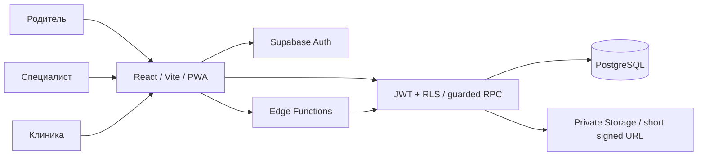

## ER и информационный граф

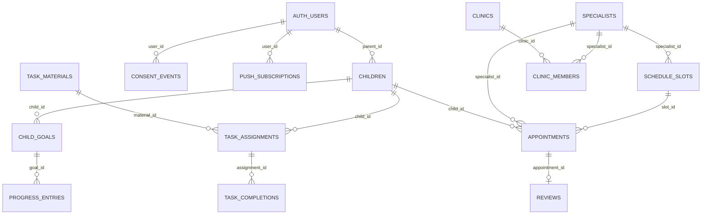

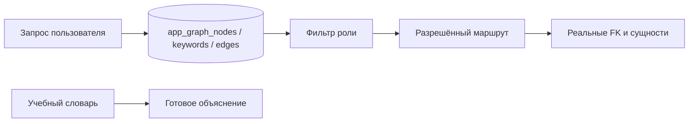

## Роли

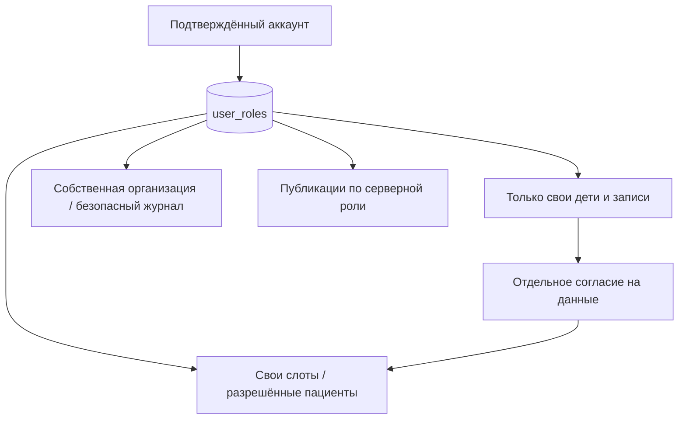

## QR и отзывы

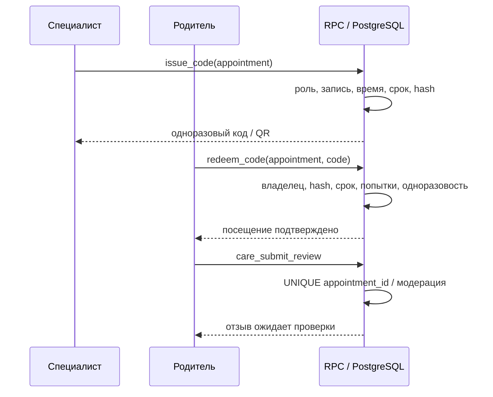

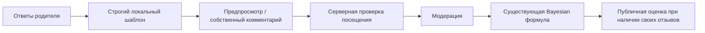

## Домашние задания

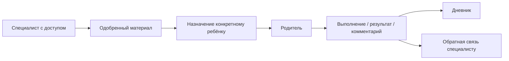

## Оплата

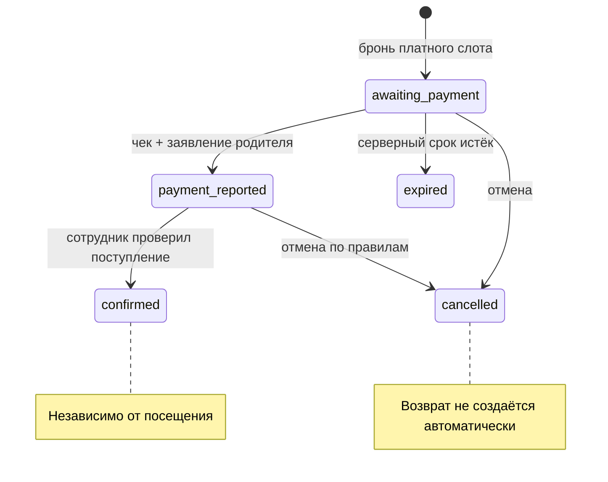

## Web Push

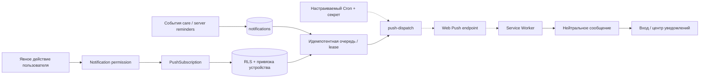

## ИИ и кэш

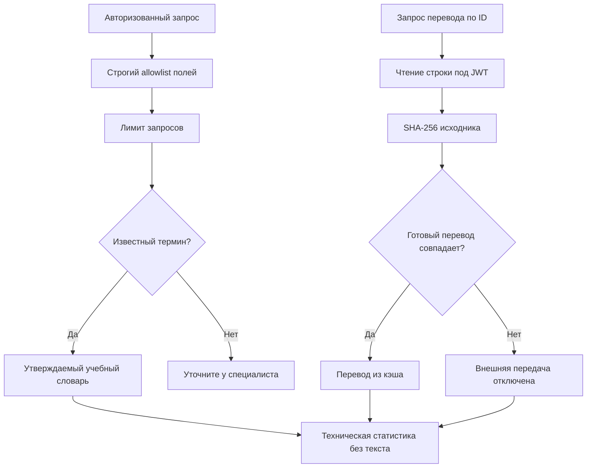

## Доставка приложения

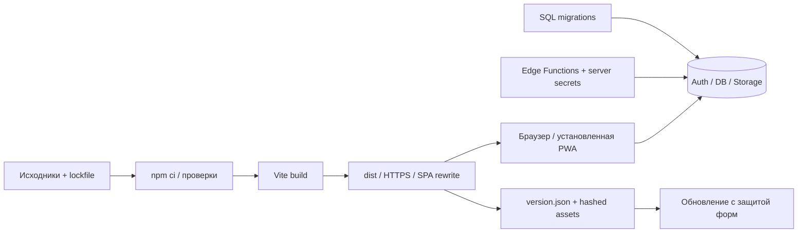
